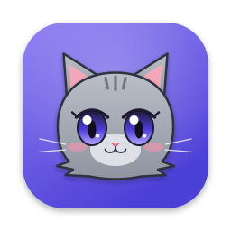

<p align="center">
  
</p>

<h1 align="center">Asya</h1>

<p align="center">
  Capture English words anywhere on your Mac and actually remember them.<br>
  <b>macOS 14+ · Apple Silicon & Intel · English → Ukrainian</b>
</p>

---

## What it does

Asya lives in your menu bar. While you read, watch or work, select an unfamiliar word in any app, right-click it and choose **Services → Add to Asya**. A small window opens with Ukrainian translations. Pick one and the word goes to your personal dictionary. Then Asya helps you learn it with spaced repetition.

- **Capture from anywhere.** Use the Services menu in any app, or the global hotkey.
- **Offline EN → UK dictionary.** It is built from Wiktionary and grouped by part of speech, with an English definition and an example. Irregular forms such as *ran → run* and *mice → mouse* are recognised.
- **Listen.** Your words play on a loop: English word, pause, Ukrainian translation. Playback continues in the background, and you control it from the menu bar.
- **Exercises with spaced repetition (SM-2).**
  - *Matching*: connect English and Ukrainian pairs, with instant feedback.
  - *Typing*: see the Ukrainian word and type the English one.
  - *Review* mode follows your schedule. *Practice* mode lets you drill as much as you like without changing the schedule.
- **Dashboard.** It shows time studied today and this week, a 7-day chart, sessions, your daily goal and **your streak**.
- Interface in **Ukrainian and English**, with light and dark themes. It respects *Reduce motion*.
- **Local first.** Your words and progress stay on your Mac.

## Install

### Homebrew (recommended)

```bash
brew install --cask maksimvovk/asya/asya
```

Update:

```bash
brew upgrade --cask asya
```

### Manual (DMG)

1. Download `Asya-<version>.dmg` from [Releases](https://github.com/MaksimVovk/homebrew-asya/releases).
2. Open it and drag **Asya** into **Applications**.
3. The first launch shows *"Asya" Not Opened*. Asya is not signed by Apple yet. Click **Done**, then open
   **System Settings → Privacy & Security**, scroll to *Security* and click **Open Anyway**.

   Or run this in the terminal:
   ```bash
   xattr -dr com.apple.quarantine /Applications/Asya.app
   ```

The Homebrew install handles this step for you.

## First steps

1. Launch Asya. A cat appears in your menu bar.
2. Select a word in Safari, Notes, a PDF or any other app, then **right-click → Services → Add to Asya**.
   - If the item doesn't appear, enable it in
     **System Settings → Keyboard → Keyboard Shortcuts → Services → Text → Add to Asya**.
     Logging out and back in can help on a fresh install.
3. Choose a translation and press **Add**.
4. Open **Exercises** every day to keep your streak.

## Privacy

- All words, progress and settings are stored locally in
  `~/Library/Containers/com.maximvovk.asya`.
- No accounts, analytics or tracking.
- The network is used only to look up words that the offline dictionary doesn't have
  ([MyMemory](https://mymemory.translated.net)) and to fetch definitions
  ([Free Dictionary API](https://dictionaryapi.dev)).

## Uninstall

```bash
brew uninstall --cask asya          # remove the app, keep your words
brew uninstall --cask --zap asya    # remove the app and all its data
```

If you installed manually, delete `/Applications/Asya.app`. To remove your data too, delete `~/Library/Containers/com.maximvovk.asya`.

## Credits

- Dictionary data: [Wiktionary](https://www.wiktionary.org), extracted via
  [kaikki.org](https://kaikki.org), licensed under
  [CC BY-SA](https://creativecommons.org/licenses/by-sa/4.0/).
- Typeface: [Inter](https://rsms.me/inter/), SIL Open Font License.

---

## Українською

**Asya** — застосунок для macOS, який допомагає запам'ятовувати англійські слова. Виділіть слово в будь-якому застосунку, натисніть **праву кнопку → Служби → Add to Asya**, оберіть переклад, і слово потрапить у ваш словник. Далі його можна прослуховувати, тренувати у вправах з інтервальним повторенням і стежити за прогресом та серією днів на панелі.

**Встановлення:**

```bash
brew install --cask maksimvovk/asya/asya
```

Або завантажте `.dmg` з [Releases](https://github.com/MaksimVovk/homebrew-asya/releases) і перетягніть Asya в «Програми». Під час першого запуску відкрийте **Системні параметри → Приватність і безпека → «Усе одно відкрити»**, бо застосунок ще не підписаний Apple.

Якщо пункт «Add to Asya» не з'являється, увімкніть його в **Системні параметри → Клавіатура → Скорочення клавіш → Служби → Текст**.

Усі дані зберігаються локально на вашому Mac.
